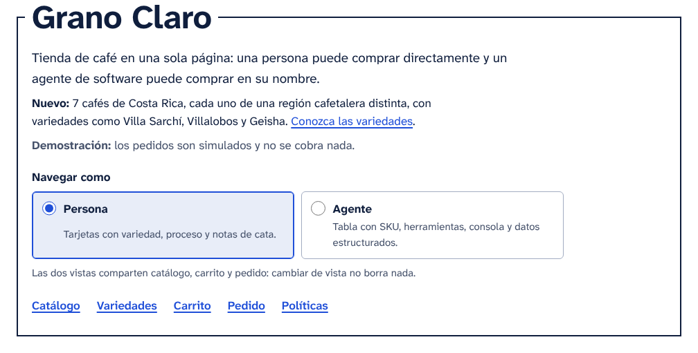
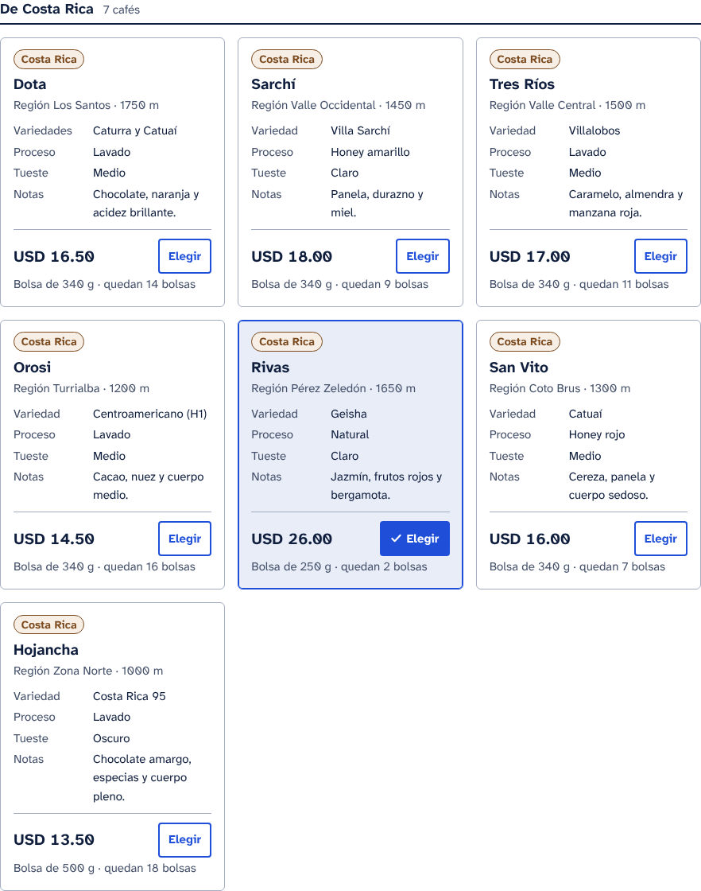
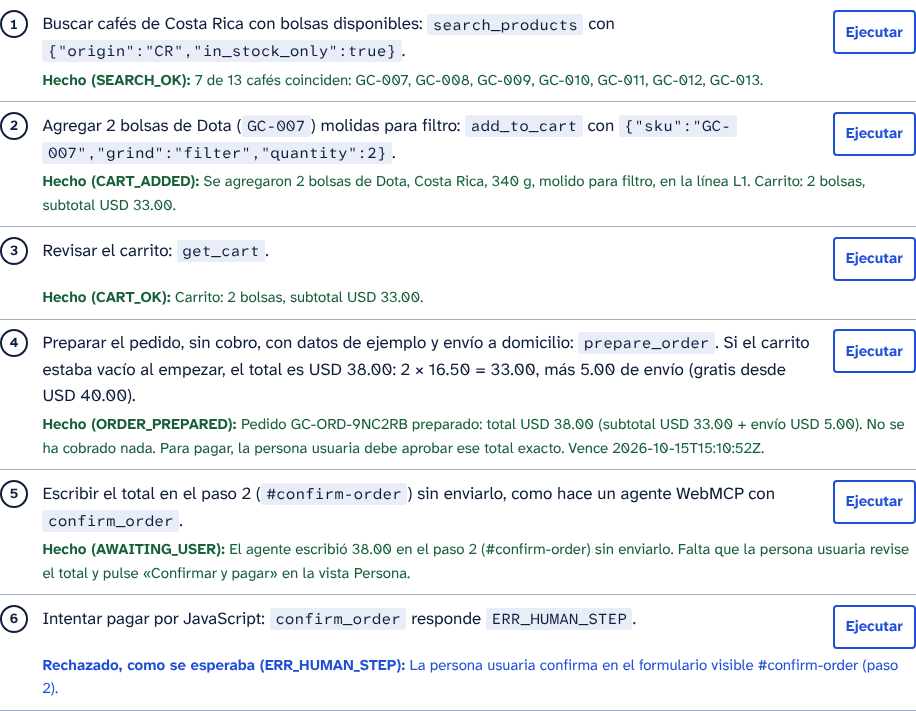

# Grano Claro

Tienda de café ficticia en una sola página, pensada para que la usen tanto personas como agentes de IA. Sirve como implementación de referencia de una arquitectura web orientada a agentes.

> **Demostración.** Los pedidos son simulados: no se cobra nada y no hay servidor.



## Versión 1.1

- **13 cafés, 7 de Costa Rica**, cada uno de una región cafetalera distinta (nombres del ICAFE de 2025): Los Santos, Valle Occidental, Valle Central, Turrialba, Pérez Zeledón, Coto Brus y Zona Norte. Las variedades incluyen Villa Sarchí, Villalobos, Centroamericano (H1), Geisha y Costa Rica 95, con filtro por variedad y una guía con fuentes.
- **Dos vistas sobre los mismos datos, el mismo carrito y el mismo pedido.** La página recuerda la elección; `#modo-agente` y `#modo-persona` abren una vista directamente.
  - *Persona*: tarjetas en lenguaje llano, con los cafés de Costa Rica primero.
  - *Agente*: tabla con SKU, guía para agentes y una consola que llama a la API y muestra el árbol de accesibilidad aproximado, el JSON-LD y los esquemas de las herramientas.
- **Pago con aprobación humana.** El agente puede preparar el pedido y escribir el total, pero solo la persona paga, desde la vista Persona. `confirm_order` por JavaScript responde `ERR_HUMAN_STEP`.

| Vista Persona | Vista Agente: recorrido de la consola |
|---|---|
|  |  |

## Estructura

| Ruta | Contenido |
|---|---|
| `index.html` | Página de la versión 1.1, autocontenida: HTML, CSS y JavaScript en un solo archivo. |
| `versions/v1.0/index.html` | Versión 1.0, conservada tal como se publicó: 6 cafés, 83 571 bytes, SHA-256 `79e8af1cf9b05cf95440ac69f1bfb24b11752b451511d22adbd46782908cf340`. |
| `build/` | Programa que genera la 1.1 a partir de la 1.0 y de `data.py`, la única lista de productos. |
| `tests/auditar_agentes.py` | Auditoría estática del HTML, sin navegador. |
| `tests/probar_pagina.py` | 55 pruebas de extremo a extremo de los requisitos de diseño R1–R9; valen para ambas versiones. |
| `tests/probar_v1_1.py` | 106 comprobaciones de lo propio de la 1.1: vistas, cafés de Costa Rica y consola. |
| `tests/ejecutar_todo.py` | Ejecuta toda la verificación (`npm test`). |
| `docs/capturas/` | Capturas de ambas vistas, en claro y en oscuro. |
| `docs/aria/` | Instantáneas ARIA (formato de Playwright) de la 1.0 y de cada vista de la 1.1. |

## Ver la página

- **En local:** abra `index.html` en el navegador. Para entrar directo a la vista Agente: `index.html#modo-agente`.
- **Con GitHub Pages:** *Settings → Pages → Build and deployment → Deploy from a branch*, rama `main`, carpeta `/ (root)`. Ahí también funcionan los filtros por URL, por ejemplo `?origin=CR&in_stock_only=true`.

## Para agentes

| Canal | Cómo se usa |
|---|---|
| JavaScript | `await granoClaro.call(nombre, argumentos)`, además de `granoClaro.tools`, `granoClaro.snapshot()` y `granoClaro.view()`. |
| WebMCP | Formularios declarativos (`toolname`) y herramientas registradas con `registerTool`, si el navegador expone WebMCP. |
| Datos | JSON-LD de schema.org y esquemas JSON en `#agent-tools`. |
| Resultados | Siempre `{ok, code, message, hint?, field?, data?}`, reflejados en `#status` con número de evento. |

Herramientas: `search_products`, `add_to_cart`, `remove_from_cart`, `get_cart`, `prepare_order` y `confirm_order` (este último lo envía solo la persona).

Los enlaces a `granoclaro.example` (OpenAPI, Markdown y `llms.txt`) apuntan a un sitio ficticio; esos archivos no forman parte de este repositorio.

## Requisitos de diseño

| | Requisito |
|---|---|
| R1 | Direccionamiento inequívoco: cada control tiene un nombre accesible único y un identificador estable. |
| R2 | Efectos observables: cada acción escribe su resultado en una región de estado persistente, con estado, código y número de evento. |
| R3 | Estabilidad perceptiva: sin superposiciones, modales, mensajes que desaparecen, animaciones ni desplazamientos del diseño; objetivos de al menos 44 px de alto. |
| R4 | Formatos canónicos: fechas ISO 8601 escritas como texto, montos con punto decimal y código ISO 4217, países ISO 3166-1 y aritmética en centavos. |
| R5 | Errores recuperables: código, causa, campo afectado y sugerencia, visibles hasta la siguiente acción. |
| R6 | Una semántica, varios transportes: formularios, herramientas WebMCP y API de script comparten entradas, salidas y códigos de error. |
| R7 | Autoridad humana: la acción con consecuencias exige la aprobación explícita de la persona. |
| R8 | Degradación elegante: la lectura funciona sin JavaScript y la acción, sin WebMCP. |
| R9 | Descubribilidad: enlaces y datos estructurados orientan a los agentes hacia la interfaz adecuada. |

## Verificación

```bash
pip install -r requirements-dev.txt     # Playwright 1.56.0 y jsonschema
python3 -m playwright install chromium
npm install                             # axe-core 4.14.0 y las fuentes de la página
npm test                                # o: python3 tests/ejecutar_todo.py
```

Resultados con Chromium 141.0.7390.37, Playwright 1.56.0, axe-core 4.14.0 y Python 3.13:

| Verificación | Versión 1.1 | Versión 1.0 |
|---|---|---|
| Auditoría estática | 0 errores: 250 ids únicos; 38 controles y 15 botones con nombres únicos; 20 encabezados sin saltos; 4 de 4 formularios declarativos coherentes; 6 esquemas válidos | 0 errores: 126 ids únicos; 24 controles y 5 botones con nombres únicos; 14 encabezados sin saltos; 4 de 4 formularios declarativos coherentes; 6 esquemas válidos |
| Extremo a extremo (55 pruebas) | 55 aprobadas | 54 aprobadas y 1 fallo conocido (R3) |
| Propias de la 1.1 | 106 de 106 | — |

**La auditoría estática** revisa identificadores, referencias ARIA, nombres accesibles, encabezados, regiones y JSON incrustado. También:

- valida los esquemas contra JSON Schema 2020-12;
- compara cada formulario declarativo con su esquema;
- cruza la tabla del catálogo con el JSON-LD;
- rechaza `alert`, `confirm`, `prompt`, selectores de fecha nativos y recursos de otros orígenes.

**Las pruebas de extremo a extremo** ubican los controles por rol y nombre accesible, como un agente que lee el árbol de accesibilidad. Además:

- llaman a la API de script y simulan WebMCP con un `document.modelContext` sustituto;
- miden el desplazamiento del diseño durante la carga (CLS);
- comprueban la ventana móvil de 390 px contra un ancho fijo, no contra el de la ventana;
- verifican la aritmética (2 × 18.50 = 37.00; 17.00 + 5.00 = 22.00; 17.00 + 29.00 = 46.00 con envío gratis);
- prueban el gobierno del pedido: total incorrecto, coma decimal, confirmación repetida, anulación al cambiar el carrito y vencimiento a los 30 minutos con un reloj simulado;
- corren axe-core en el estado inicial, con un pedido en curso y en tema oscuro.

**Fallo conocido de la 1.0 (R3).** En la 1.0, los botones de opción de la tabla miden 21 px y los botones «Quitar», 36 px, por debajo de los 44 px del requisito. La 1.1 los corrige: un área de clic de 44 px para cada botón de opción y botones pequeños de 44 px.

**Límites.** WebMCP solo se prueba con un sustituto, porque ningún navegador estable lo expone. La auditoría no revisa los archivos del sitio porque no están en el repositorio.

## Reconstruir

```bash
python3 build/build.py             # regenera index.html
python3 build/build.py --artifact  # además, dist/grano-claro.artifact.html (fragmento para artefactos de claude.ai)
```

No necesita dependencias (probado con Python 3.13). Cada reemplazo sobre la 1.0 debe coincidir exactamente una vez, y la 1.0 se verifica por su SHA-256: si la base cambia, el programa se detiene en lugar de generar una página incoherente. Para cambiar el catálogo, edite `build/data.py`.

## Datos y fuentes

Precios, existencias, altitudes y notas de cata son **ficticios**, como la tienda. Variedades y regiones de Costa Rica (fuentes consultadas el 13 de octubre de 2026):

- Regiones: F. Ruiz León, [«Tres Ríos desaparece del mapa de las regiones cafetaleras de Costa Rica; vea todos los cambios que hizo el Icafé»](https://www.elfinancierocr.com/economia-y-politica/tres-rios-desaparece-del-mapa-de-las-regiones/YPE3AYVL7JHVFOHPLYZM3VWHQM/story/), *El Financiero*, 22 de junio de 2025.
- Linaje de T5296 y de Centroamericano: [World Coffee Research, «T5296»](https://varieties.worldcoffeeresearch.org/varieties/t5296).
- Ozone Coffee: [Villa Sarchí](https://ozonecoffee.co.uk/blogs/varietals/coffee-varietal-villa-sarchi), [Caturra](https://ozonecoffee.co.uk/blogs/varietals/coffee-varietal-caturra), [Catuaí](https://ozonecoffee.co.uk/blogs/varietals/coffee-varietal-catuai) y [Centroamericano](https://ozonecoffee.co.uk/blogs/varietals/coffee-varietal-centroamericano).
- Sweet Maria's: [Villalobos](https://library.sweetmarias.com/glossary/villalobos/) y [Costa Rica 95](https://library.sweetmarias.com/glossary/costa-rica-95-cr95-variety/).
- [Wikipedia, «Geisha (coffee)»](https://en.wikipedia.org/wiki/Geisha_(coffee)).

## Versiones

- **1.0:** 6 cafés y una sola vista; pesa 83,6 kB.
- **1.1:** 13 cafés, vistas Persona y Agente, consola y objetivos de 44 px; pesa 149,4 kB. GC-001 a GC-006 conservan precio y existencias, de modo que los flujos de la 1.0 se reproducen igual en la 1.1.

## Licencia

[MIT](LICENSE) © 2026 Johan Carvajal Godínez.
